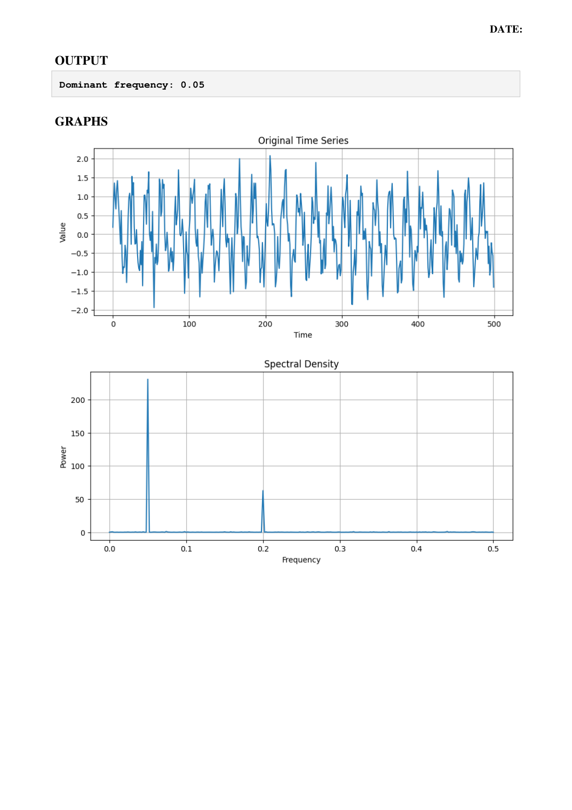
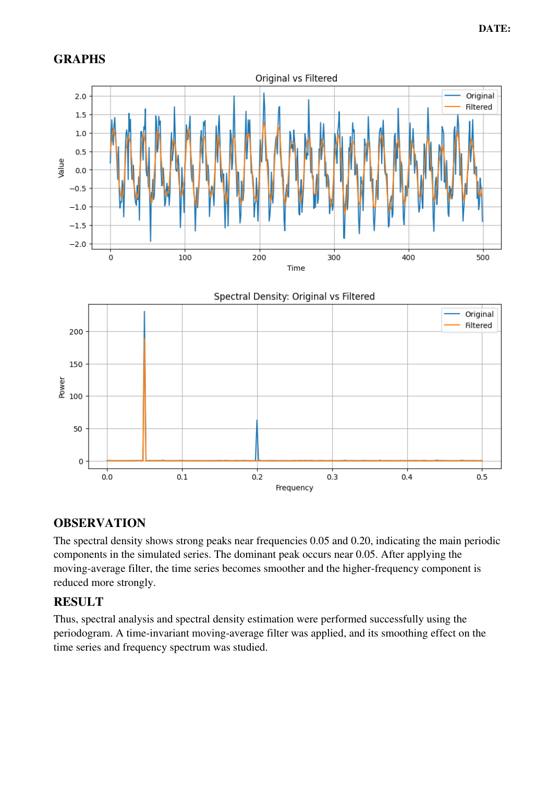

# Experiment 07 – Spectral Analysis, Spectral Density and Time-Invariant Linear Filters

## Student Details

- **Name:** HANIEL REENA D R
- **Register No:** 2305001008

## Aim
To simulate a time series, calculate its spectral density, perform spectral analysis using the
periodogram, and study the effect of a time-invariant linear filter.

## Algorithm
1. Import NumPy, Matplotlib and SciPy signal functions.
2. Generate 500 time points.
3. Create a simulated signal containing frequencies 0.05 and 0.20 with random noise.
4. Plot the original time series.
5. Calculate the periodogram and plot the spectral density.
6. Find the dominant frequency using the maximum spectral peak.
7. Apply a 5-point moving-average filter.
8. Compare the original and filtered time series.
9. Calculate the spectra of the original and filtered signals.
10. Compare the spectral densities before and after filtering.

## Python Program
File: `experiment_07.py`

```python
import numpy as np
import matplotlib.pyplot as plt
from scipy import signal
n = 500
t = np.arange(n)
x = (
    np.sin(2 * np.pi * 0.05 * t)
    + 0.5 * np.sin(2 * np.pi * 0.20 * t)
    + 0.3 * np.random.randn(n)
)
plt.figure(figsize=(10, 4))
plt.plot(t, x)
plt.title("Original Time Series")
plt.xlabel("Time")
plt.ylabel("Value")
plt.grid(True)
plt.show()
frequency, power = signal.periodogram(x)
plt.figure(figsize=(10, 4))
plt.plot(frequency, power)
plt.title("Spectral Density")
plt.xlabel("Frequency")
plt.ylabel("Power")
plt.grid(True)
plt.show()

peak_index = np.argmax(power)
print("Dominant frequency:", frequency[peak_index])
window = 5
filtered = np.convolve(
    x,
    np.ones(window) / window,
    mode="same"
)
plt.figure(figsize=(10, 4))
plt.plot(t, x, label="Original")
plt.plot(t, filtered, label="Filtered")
plt.title("Original vs Filtered")
plt.xlabel("Time")
plt.ylabel("Value")
plt.legend()
plt.grid(True)
plt.show()
f1, p1 = signal.periodogram(x)
f2, p2 = signal.periodogram(filtered)
plt.figure(figsize=(10, 4))
plt.plot(f1, p1, label="Original")
plt.plot(f2, p2, label="Filtered")
plt.title("Spectral Density: Original vs Filtered")
plt.xlabel("Frequency")
plt.ylabel("Power")
plt.legend()
plt.grid(True)
plt.show()
```

## Output
### Output Page 3


### Output Page 4


## Observation
The spectral density shows strong peaks near frequencies 0.05 and 0.20, indicating the main periodic
components in the simulated series. The dominant peak occurs near 0.05. After applying the
moving-average filter, the time series becomes smoother and the higher-frequency component is
reduced more strongly.

## Result
Thus, spectral analysis and spectral density estimation were performed successfully using the
periodogram. A time-invariant moving-average filter was applied, and its smoothing effect on the
time series and frequency spectrum was studied.

## Installation and Execution
Install the listed libraries:
```bash
pip install -r requirements.txt
```

Run the Python program from this folder:
```bash
python experiment_07.py
```

_Program and output images are transcribed/rendered from the supplied lab PDF._